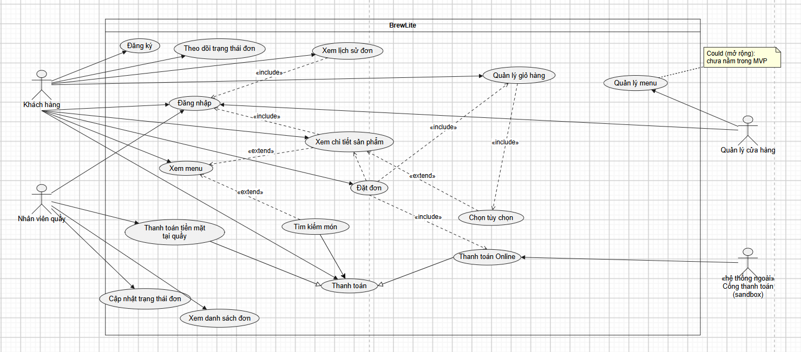
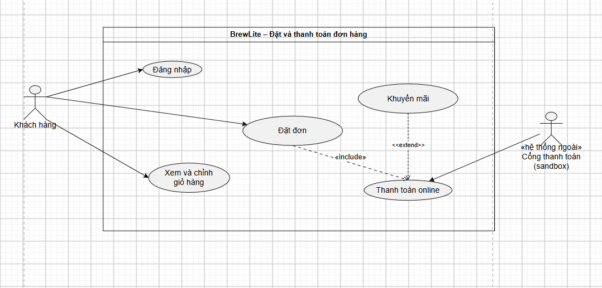

# Task 1 Khai thác và đặc tả yêu cầu

# Task 1.1 - Bối cảnh, Stakeholder và Phạm vi

## 1. Vấn đề nghiệp vụ
- Hiện trạng: quán nhận order thủ công (giấy/miệng), dễ nhầm món, chậm
  vào giờ cao điểm, khó thống kê doanh thu.
- Vấn đề: khách chờ lâu, nhân viên quầy quá tải, quản lý thiếu số liệu.
- Giải pháp: hệ thống BrewLite cho phép đặt món, quản lý đơn,
  thanh toán và xem báo cáo.

## 2. Stakeholder, mục tiêu và kỳ vọng
| Stakeholder | Vai trò | Mục tiêu | Kỳ vọng |
|---|---|---|---|
| Khách hàng | Đặt đồ uống | Đặt nhanh, đúng món | Giao diện dễ dùng, xem trạng thái đơn |
| Nhân viên quầy | Xử lý đơn | Nhận và pha đúng đơn | Danh sách đơn rõ ràng, cập nhật trạng thái nhanh |
| Quản lý cửa hàng | Quản lý menu, doanh thu | Kiểm soát hoạt động | Quản lý menu, xem báo cáo |
| Giảng viên / khách hàng nghiệm thu | Đánh giá sản phẩm | Sản phẩm đúng yêu cầu | Demo chạy được, tài liệu đầy đủ |
| Nhóm phát triển | Xây dựng hệ thống | Hoàn thành đúng hạn | Yêu cầu rõ, phạm vi vừa sức |
| Đơn vị thanh toán | Cung cấp cổng thanh toán | Giao dịch đúng, an toàn | Tích hợp theo API/chuẩn của họ |

=======
## 3. Phạm vi
### 3.1 In-scope (MVP)
| ID | Luồng | Chức năng MVP |
| :--- | :--- | :--- |
| MVP-01 | Xem menu | Xem danh sách đồ uống, giá, mô tả |
| MVP-02 | Chọn tùy chọn | Chọn size, đường, đá, topping |
| MVP-03 | Giỏ hàng | Thêm, sửa số lượng, xóa món, xem tổng tiền |
| MVP-04 | Đặt đơn | Xác nhận giỏ hàng thành đơn hàng |
| MVP-05 | Thanh toán | Thanh toán giả lập (sandbox)|
| MVP-06 | Theo dõi đơn | Khách xem trạng thái: Mới → Đang pha → Sẵn sàng → Hoàn tất |
| MVP-07 | (hỗ trợ MVP-06) | Nhân viên quầy xem đơn và cập nhật trạng thái |
| MVP-08 | Đăng nhập, đăng ký | Tạo tài khoản, định danh khách hàng |
| MVP-09 | Lịch sử đơn | Xem lại những đơn hàng đã mua |

### 3.2 Phạm vi mở rộng (làm nếu còn thời gian)
- Quản lý menu cho quản lý cửa hàng (thêm, sửa, xóa món)
- Báo cáo doanh thu
- Tài khoản khách, lịch sử đơn
- Khuyến mãi, tích điểm
- Thông báo khi đơn xong

### 3.3 Out-of-scope (không thực hiện)
- Ứng dụng mobile native
- Quản lý kho nguyên liệu chi tiết
- Quản lý nhân sự, chấm công
- Tích hợp thanh toán thật (production)
- Giao hàng và tracking shipper
- Thanh toán tiền mặt 
## 4.Giả định, ràng buộc và các rủi ro ban đầu.
### 4.1 Giả định
| ID | Giả định |
|---|---|
| A-01 | Mỗi cửa hàng dùng một hệ thống độc lập |
| A-02 | Người dùng có kết nối internet ổn định |
| A-03 | Thanh toán dùng sandbox/giả lập khi demo |
| A-04 | Khách hàng phải có tài khoản |

### 4.2 Ràng buộc
| ID | Ràng buộc |
|---|---|
| C-01 | Hoàn thành trong thời gian của môn học |
| C-02 | Nhóm nhỏ, kỹ năng hạn chế |
| C-03 | Dùng công nghệ miễn phí / mã nguồn mở |
| C-04 | Phải demo được sản phẩm chạy |

### 4.3 Rủi ro ban đầu
| ID | Rủi ro | Mức độ | Hướng xử lý |
|---|---|---|---|
| R-01 | Phạm vi phình to | Cao | Chốt MVP, đưa phần còn lại vào mở rộng |
| R-02 | Thành viên chậm tiến độ | Trung bình | Chia task nhỏ, họp nhóm hàng tuần |
| R-03 | Tích hợp thanh toán phức tạp | Trung bình | Dùng sandbox hoặc giả lập |
| R-04 | Yêu cầu thay đổi muộn | Trung bình | Ghi nhận và quản lý thay đổi |

# Task 1.2 - Yêu cầu chức năng và phi chức năng 
## 1. Yêu cầu chức năng 
| ID | Nhóm | Yêu cầu | MoSCoW | Tiêu chí chấp nhận |
| :--- | :--- | :--- | :--- | :--- |
| FR-01 | Menu | Hệ thống phải hiển thị danh sách đồ uống theo danh mục | Must | Mở trang menu thấy đủ món và danh mục đã seed |
| FR-02 | Menu | Hệ thống phải cho phép tìm món theo tên | Should | Gõ "cà phê" chỉ hiện món có tên chứa "cà phê" |
| FR-03 | Chi tiết sản phẩm | Hệ thống phải hiển thị tên, giá, mô tả, ảnh của món | Must | Bấm vào món thấy đủ 4 thông tin |
| FR-04 | Chi tiết sản phẩm | Hệ thống phải cho chọn tùy chọn (size, đường, đá, topping) | Must | Chọn tùy chọn thì giá tạm tính cập nhật đúng |
| FR-05 | Giỏ hàng | Hệ thống phải cho thêm món kèm tùy chọn vào giỏ | Must | Sau khi thêm, giỏ có món với đúng tùy chọn và số lượng |
| FR-06 | Giỏ hàng | Hệ thống phải cho sửa số lượng và xóa món | Must | Đổi số lượng thì tổng tiền tính lại đúng |
| FR-07 | Giỏ hàng | Hệ thống phải giữ giỏ khi người dùng tải lại trang | Should | F5 không làm mất giỏ |
| FR-08 | Xác thực | Hệ thống phải cho khách đăng ký bằng email và mật khẩu | Must | Đăng ký thành công thì có tài khoản; email trùng bị từ chối |
| FR-09 | Xác thực | Hệ thống phải cho người dùng đăng nhập và đăng xuất | Must | Sai mật khẩu bị từ chối; đăng xuất thì không vào được trang cần đăng nhập |
| FR-10 | Xác thực | Hệ thống phải phân quyền khách hàng và nhân viên | Must | Khách không vào được trang của nhân viên |
| FR-11 | Đặt đơn | Hệ thống phải tạo đơn từ giỏ hàng khi khách xác nhận | Must | Sau khi đặt, giỏ rỗng và đơn có mã, tổng tiền đúng |
| FR-12 | Đặt đơn | Hệ thống phải từ chối đặt đơn khi giỏ rỗng | Must | Bấm đặt với giỏ rỗng thì báo lỗi, không tạo đơn |
| FR-13 | Thanh toán | Hệ thống phải cho thanh toán qua cổng giả lập (sandbox) | Must | Thanh toán thành công thì đơn chuyển sang "Đã thanh toán" |
| FR-14 | Thanh toán | Hệ thống phải xử lý thanh toán thất bại | Must | Thanh toán lỗi thì đơn không bị đánh dấu đã thanh toán, khách có thể thử lại |
| FR-15 | Lịch sử đơn | Hệ thống phải cho khách xem danh sách đơn đã đặt | Must | Khách chỉ thấy đơn của mình, mới nhất đứng đầu |
| FR-16 | Lịch sử đơn | Hệ thống phải cho xem chi tiết một đơn cũ | Should | Mở đơn thấy món, tùy chọn, tổng tiền, trạng thái |
| FR-17 | Quản lý trạng thái đơn | Hệ thống phải cho nhân viên xem danh sách đơn mới | Must | Đơn vừa đặt xuất hiện ở màn hình nhân viên |
| FR-18 | Quản lý trạng thái đơn | Hệ thống phải cho nhân viên đổi trạng thái đơn theo thứ tự Mới → Đang pha → Sẵn sàng → Hoàn tất | Must | Không cho nhảy cóc trạng thái (Mới → Hoàn tất bị từ chối) |
| FR-19 | Quản lý trạng thái đơn | Hệ thống phải cho khách xem trạng thái đơn hiện tại | Must | Nhân viên đổi trạng thái thì khách thấy trạng thái mới sau khi làm mới |
| FR-20 | Menu | Hệ thống nên cho quản lý thêm, sửa, xóa món | Could | Món thêm mới xuất hiện trên menu |
| FR-21 | Thanh toán | Hệ thống sẽ không tích hợp cổng thanh toán thật | Won't | (đưa vào bản sau) |
| FR-22 | Đặt đơn | Hệ thống sẽ không hỗ trợ giao hàng tận nơi | Won't | (đưa vào bản sau) |
| FR-23 | Thanh toán | Hệ thống không hỗ trợ thanh toán tiền mặt | Won't | (đưa vào bản sau) |
| FR-24 | Trạng thái đơn | Hệ thống cho nhân viên xem tình trạng thanh toán của đơn hàng (Chờ thanh toán / Đã thanh toán / Thất bại) | Must | Không chuyển thành hoàn tất nếu chưa thanh toán | 

## 2. Yêu cầu phi chức năng 

| ID | Nhóm | Yêu cầu | MoSCoW | Tiêu chí chấp nhận |
| :--- | :--- | :--- | :--- | :--- |
| NFR-01 | Hiệu năng | Trang menu phải tải nhanh | Must | Dưới 3 giây với 50 món, mạng thường |
| NFR-02 | Hiệu năng | Thao tác đặt đơn phải phản hồi nhanh | Should | Dưới 2 giây ở 95% lần thử với 20 người dùng đồng thời |
| NFR-03 | Bảo mật | Mật khẩu phải được băm, không lưu dạng rõ | Must | Xem CSDL không thấy mật khẩu gốc |
| NFR-04 | Bảo mật | Dữ liệu truyền tải phải dùng HTTPS | Must | Trang production truy cập qua HTTPS |
| NFR-05 | Bảo mật | Người dùng chỉ truy cập được dữ liệu thuộc quyền của mình | Must | Khách A không xem được đơn của khách B qua đổi ID trên URL |
| NFR-06 | Tính khả dụng | Giao diện phải dùng được trên điện thoại | Must | Hiển thị đúng ở màn hình 375 px, không phải kéo ngang |
| NFR-07 | Tính khả dụng | Khách mới phải đặt được đơn mà không cần hướng dẫn | Should | 3 người chưa dùng thử đặt được đơn trong dưới 3 phút |
| NFR-08 | Tính khả dụng | Thông báo lỗi phải rõ ràng, nêu cách khắc phục | Should | Sai mật khẩu hiện thông báo dễ hiểu |
| NFR-09 | Khả năng triển khai | Hệ thống phải chạy được từ repo bằng một lệnh | Must | `docker compose up` (hoặc lệnh tương đương) chạy được trên máy sạch |
| NFR-10 | Khả năng triển khai | Cấu hình phải tách khỏi mã nguồn | Should | Đổi biến môi trường không cần sửa code |
| NFR-11 | Khả năng triển khai | Hệ thống phải deploy tự động lên production qua CI/CD | Should | Merge vào nhánh chính thì bản production cập nhật |
| NFR-13 | Bảo mật | Không lưu thông tin thẻ, chỉ lưu mã giao dịch | Must | Ở CSDL chỉ lưu mã giao dịch |

## 3. Sơ đồ UseCase tổng quát cho hệ thống 

# Task 1.3 - Đặc tả một use-case trọng tâm
## 1. Vẽ sơ đồ Usecase trọng tâm 

## 2. Mô tả actor, trigger, tiền điều kiện và hậu điều kiện
### Actors
* **Tác nhân chính (Primary Actor):** Khách hàng (đã đăng nhập vào hệ thống BrewLite).
* **Tác nhân hỗ trợ / Hệ thống ngoài (Supporting / External Actor):** Cổng thanh toán (sandbox).

### Trigger (Hành động kích hoạt)
* Khách hàng bấm nút "Đặt đơn" (hoặc "Thanh toán") từ màn hình xem giỏ hàng.

### Tiền điều kiện (Preconditions)
* Khách hàng đã đăng nhập thành công vào hệ thống BrewLite.
* Giỏ hàng có ít nhất một sản phẩm hợp lệ kèm tùy chọn (size, đường, đá, topping).
* Cổng thanh toán giả lập (Sandbox) đang ở trạng thái hoạt động bình thường.

### Hậu điều kiện (Postconditions)
* Đơn hàng mới được tạo và lưu thành công vào CSDL với trạng thái ban đầu là "Mới" và tình trạng thanh toán là "Đã thanh toán".
* Mã giao dịch từ cổng thanh toán sandbox được ghi nhận vào đơn hàng (không lưu thông tin thẻ/tài khoản).
* Giỏ hàng hiện tại của khách hàng được làm trống.
* Đơn hàng hiển thị tức thì trên danh sách chờ xử lý của nhân viên quầy; khách hàng được điều hướng sang màn hình theo dõi đơn hàng.
## 3. Mô tả luồng chính, luồng thay thế và luồng ngoại lệ
### 3.1 Luồng chính 
| Bước | Thực hiện bởi | Hành động | Phản hồi của Hệ thống |
| :---: | :--- | :--- | :--- |
| 1 | Khách hàng | Mở giỏ hàng | Hệ thống hiển thị danh sách các món đã chọn, chi tiết tùy chọn (size, đường, đá, topping), số lượng từng món và tổng tiền tạm tính. |
| 2 | Khách hàng | Bấm nút "Đặt đơn" | Hệ thống kiểm tra đăng nhập của khách hàng và kiểm tra giỏ hàng: xác thực giỏ không rỗng, đối chiếu món và giá bán hiện hành. |
| 3 | Hệ thống | Hiển thị màn hình xác nhận đơn | Hệ thống hiển thị thông tin tóm tắt đơn hàng, tổng tiền cần thanh toán và tùy chọn thanh toán trực tuyến qua cổng Sandbox. |
| 4 | Khách hàng | Bấm "Xác nhận thanh toán" | Hệ thống tạo đơn hàng tạm với trạng thái "Chờ thanh toán", tạo yêu cầu giao dịch và chuyển hướng khách sang giao diện Cổng thanh toán (sandbox). |
| 5 | Cổng thanh toán (sandbox) | Cung cấp giao diện thanh toán | Cổng thanh toán hiển thị màn hình thanh toán giả lập kèm số tiền tương ứng với đơn hàng. |
| 6 | Khách hàng | Xác thực thanh toán | Khách hàng chọn phương thức giả lập và xác nhận hoàn tất giao dịch trên giao diện sandbox. |
| 7 | Cổng thanh toán (sandbox) | Phản hồi kết quả thanh toán | Cổng thanh toán ghi nhận giao dịch thành công và gửi tín hiệu phản hồi (kèm mã giao dịch) về cho hệ thống BrewLite. |
| 8 | Hệ thống | Cập nhật dữ liệu đơn hàng | Hệ thống xác thực phản hồi, cập nhật tình trạng đơn hàng thành "Đã thanh toán", gán trạng thái xử lý là "Mới", lưu mã giao dịch và xóa trắng giỏ hàng của khách. |
| 9 | Hệ thống | Thông báo thành công và chuyển hướng | Hệ thống gửi đơn hàng vào danh sách xử lý của nhân viên quầy, hiển thị thông báo "Thanh toán thành công" và tự động điều hướng khách hàng sang màn hình theo dõi trạng thái đơn hàng. |
### 3.2 Luồng thay thế (Alternative Flows)

| Mã | Tại bước | Điều kiện | Xử lý |
| :--- | :---: | :--- | :--- |
| A1 | Bước 3 | Khách chọn thanh toán trực tuyến qua cổng/QR (MoMo, VNPay) thay vì COD | Hệ thống chuyển sang cổng thanh toán, hiển thị mã QR kèm số tiền và nội dung chuyển khoản. Khách quét mã thanh toán. Khi nhận tín hiệu thành công từ cổng thanh toán, hệ thống cập nhật trạng thái đơn thành "Đã thanh toán" và tiếp tục sang bước 5 của luồng chính. |
| A2 | Bước 2 | Khách muốn sửa/xóa món, thay đổi số lượng ngay tại màn hình đặt đơn | Khách bấm nút "Chỉnh sửa giỏ hàng", hệ thống cho phép thay đổi số lượng hoặc xóa món, sau đó tính lại tổng tiền và quay lại bước 1 của luồng chính. |
| A3 | Bước 3 | Khách áp dụng mã giảm giá (Voucher) | Khách nhập mã voucher vào ô ưu đãi. Hệ thống kiểm tra tính hợp lệ của mã, tính toán lại số tiền giảm giá và hiển thị số tiền thanh toán cuối cùng trước khi bấm xác nhận. |

### 3.3 Luồng ngoại lệ (Exception Flows)

| Mã | Tại bước | Tình huống | Xử lý |
| :--- | :---: | :--- | :--- |
| E1 | Bước 1 | Giỏ hàng bị trống khi bấm đặt đơn | Hệ thống hiển thị thông báo lỗi "Giỏ hàng của bạn đang trống", từ chối tạo đơn hàng và điều hướng khách quay lại trang Menu để chọn món. |
| E2 | Bước 3 | Món ăn hoặc Topping trong giỏ hàng bị hết hàng/ngừng bán giữa chừng | Hệ thống kiểm tra kho và phát hiện món/topping không đủ tồn kho, hiển thị thông báo "Sản phẩm [Tên món] vừa hết hàng", yêu cầu khách xóa hoặc thay đổi món đó ra khỏi giỏ hàng trước khi tiếp tục. |
| E3 | Bước 2 | Khách nhập thiếu hoặc sai định dạng số điện thoại, để trống địa chỉ nhận hàng | Hệ thống đánh dấu đỏ các trường dữ liệu không hợp lệ, hiển thị thông báo hướng dẫn sửa lỗi và chặn không cho phép bấm nút xác nhận đặt hàng cho đến khi dữ liệu chuẩn xác. |
| E4 | A1 | Cổng thanh toán online bị lỗi, quá thời gian chờ (Timeout) sau 5 phút hoặc giao dịch bị từ chối | Hệ thống nhận phản hồi lỗi từ cổng thanh toán, hiển thị thông báo "Giao dịch thanh toán thất bại hoặc quá hạn", giữ nguyên đơn hàng ở trạng thái "Chờ thanh toán" và cung cấp nút bấm cho phép khách thử thanh toán lại. |

## 4. Liên kết use-case với các mã yêu cầu tương ứng 

| Nội dung use-case | Mã yêu cầu | Mã MVP |
|---|---|---|
| Xem và sửa giỏ hàng trước khi đặt | FR-03, FR-05, FR-06 | MVP-03 |
| Yêu cầu đăng nhập tài khoản trước khi đặt đơn | FR-08, FR-09, FR-10 | MVP-08 |
| Kiểm tra giỏ hàng và khởi tạo đơn hàng | FR-11, FR-12 | MVP-04 |
| Thực hiện thanh toán trực tuyến qua cổng giả lập (Sandbox/QR) | FR-13, FR-14, NFR-12, NFR-13 | MVP-05 |
| Kiểm tra và xác nhận tình trạng thanh toán | FR-24 | MVP-05 |
| Chuyển hướng và xem trạng thái đơn hàng sau khi đặt thành công | FR-07, FR-15, FR-19 | MVP-06, MVP-09 |
| Xử lý thanh toán thất bại | FR-15M | VP-05 |
| Đảm bảo phản hồi nhanh khi đặt hàng (Hiệu năng) | NFR-01, NFR-02 | MVP-04 |
| Hiển thị tối ưu trên giao diện di động (Mobile-first / PWA) | NFR-06, NFR-07 | MVP-01 |
| Đảm bảo an toàn thông tin và bảo mật đường truyền (JWT, HTTPS) | NFR-03, NFR-04, NFR-05 | MVP-08 |

## 5. Ngoài phạm vi Usecase (Hệ thống không làm)
• Không hỗ trợ thanh toán tiền mặt hay thanh toán tại quầy.
• Không lưu thẻ cho lần sau.
• Không hoàn tiền, không sửa đơn sau khi đặt.
• Không giao hàng tận nơi.

## 6. Tiêu chí chấp nhận
| ID | Tình huống | Bối cảnh | Hành động | Kết quả mong đợi |
| :--- | :--- | :--- | :--- | :--- |
| AC-01 | Đặt và thanh toán thành công | Khách đã đăng nhập, giỏ không trống | Bấm “Thanh toán”, cổng trả thành công | Có đơn trạng thái “Mới”, thanh toán “Đã thanh toán”, đã lưu mã giao dịch, giỏ rỗng, nhân viên thấy đơn |
| AC-02 | Tổng tiền đúng | Giỏ có 1 món 40.000đ, topping 5.000đ, số lượng 2 | Đặt đơn | Tổng tiền đơn là 90.000đ |
| AC-03 | Giỏ rỗng | Khách đã đăng nhập, giỏ rỗng | Bấm “Đặt hàng” | Hiện lỗi, không có đơn mới |
| AC-04 | Thanh toán thất bại | Đơn “Chờ thanh toán” | Cổng trả thất bại | Đơn không thành “Đã thanh toán”, khách thử lại được, giỏ còn |
| AC-05 | Hủy sau khi thất bại | Đơn “Chờ thanh toán” sau lần thanh toán lỗi | Khách chọn hủy đơn | Thanh toán thành “Đã hủy”, nhân viên không thấy đơn |
| AC-06 | Cổng quá thời gian | Đơn “Chờ thanh toán” | Cổng không phản hồi | Hiện thông báo, đơn không bị đánh dấu đã thanh toán |
| AC-07 | Chưa đăng nhập | Khách chưa đăng nhập, giỏ có món | Bấm “Đặt hàng” | Chuyển sang đăng nhập, sau đó giỏ vẫn còn |
| AC-08 | Món hết hàng | Giỏ có món đã ngừng bán | Bấm “Đặt hàng” | Hiện tên món lỗi, không tạo đơn |
| AC-09 | Bấm đúp | Khách ở màn hình xác nhận | Bấm “Thanh toán” hai lần liên tiếp | Chỉ có một đơn được tạo |
| AC-10 | Kết quả trùng lặp | Đơn đã “Đã thanh toán” | Cổng gửi lại kết quả thành công | Đơn không đổi, chỉ có một bản ghi thanh toán |
| AC-11 | Kết quả sai số tiền | Đơn “Chờ thanh toán” 90.000đ | Cổng gửi thành công với số tiền khác | Đơn vẫn “Chờ thanh toán”, có log |
| AC-12 | Đơn chưa trả tiền | Đơn “Chờ thanh toán” | Nhân viên mở danh sách đơn | Không thấy đơn này |
| AC-13 | Quá hạn thanh toán | Đơn “Chờ thanh toán” quá 15 phút | Hệ thống kiểm tra định kỳ | Đơn thành “Đã hủy” |
| AC-14 | Phân quyền | Khách A đã đặt đơn | Khách B mở link đơn của A | Bị từ chối truy cập |
